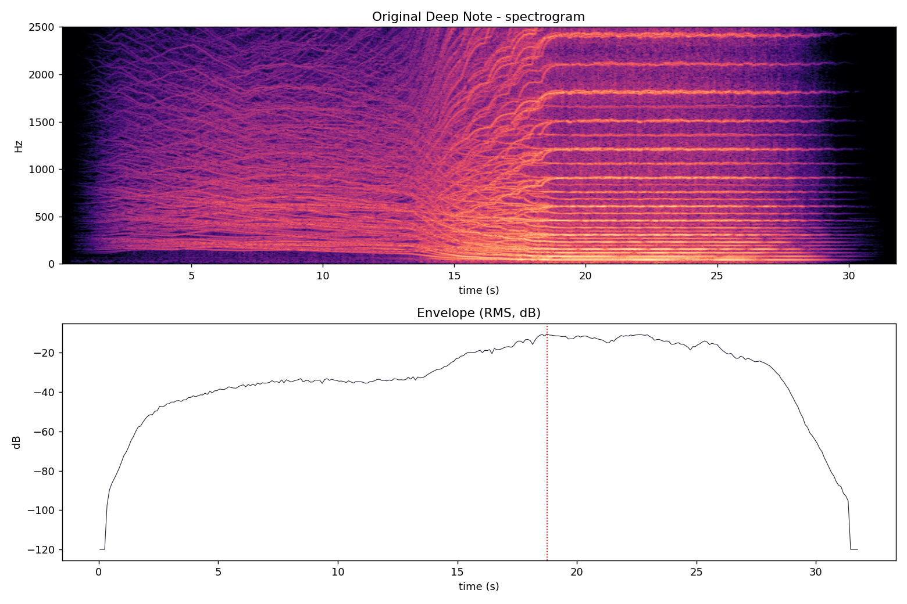

# THX Deep Note — a Python recreation

A 30-voice additive synthesizer that recreates the famous **THX Deep Note**: a cluster of drifting tones that dives, soars and lands on a huge, shimmering D chord.

Created originally in 1982 by [Dr. James A. "Andy" Moorer](https://en.wikipedia.org/wiki/James_A._Moorer) of Lucasfilm.  This recreation was written in Python by **Aram Basmadjian** (2026).



*Analysis of the [original recording](https://www.thx.com/deepnote/), which this recreation was based on: 30 voices wander, cross, and converge on the final chord at about 18 s.*

---

## Features

- **30 independent voices**, each built from up to 16 harmonics (Dr. James A. Moorer's 1982 original used 12), rendered with a fast Chebyshev recurrence.
- **Four phases**: wander → dive → hold → release, with timing calculated from the voices themselves rather than hard-coded.
- **A lead voice** that swells, then dives alone from above the cluster to D1 before the rest follow.
- **Crossed trajectories**: the voices that start highest end up in the bass, so the dive and the climb cross each other, as they do in the original.
- **Just-intonation D chord** (D1 to A6) with deliberate unison detuning, so doubled notes shimmer instead of cancelling out.
- **Evolving timbre**: a body formant, a presence peak and a low-pass filter that opens with the crescendo, like a bowed string played harder.
- **Organic final chord**: slow per-voice pitch drift and independently changing upper harmonics (both optional).
- **Stereo staging**: an early left-to-right sweep, then a "bloom" in which the voices spread to their full stereo positions between 8 and 12 s.
- **Reproducible**: the same randon number generator seed and settings always give the same audio.
- **Export**: 16-bit PCM, 24-bit PCM or 32-bit float WAV file.

## How it sounds, phase by phase

| Phase | Approximate time | What happens |
| --- | --- | --- |
| **1. Wander** | 0.5–11 s | Voices enter one at a time between 0.5 and 5 s and drift randomly around 140–270 Hz at a quiet level (−22 dB). The whole cluster sweeps from left to right and back to center. |
| **2. Dive** | 7.5–19 s | The lead voice dives alone starting at 7.5 s. From about 11 s, bass-bound voices dive and treble voices soar upward. A ~22 dB crescendo and a filter that opens up go along with it. |
| **3. Hold** | ~19–24 s | The full chord sustains for 5.2 s. Individual pitches and harmonics keep moving very slightly. |
| **4. Release** | ~24–31.5 s | A gentle sag (the treble fades fastest), then a cos² fade and 1 s of silence. |

The final chord is **D1 A1 D2 A2 D3 A3 D4 A4 D5 A5 F♯6 A6** in just intonation, with `3 1 4 1 4 3 3 2 2 2 2 3` voices on those notes. This voicing follows Dr. Moorer's [published score](https://www.thx.com/deepnote/). D1 is tuned to 37.8 Hz to match the [reference recording](https://www.thx.com/deepnote/), which sits about half a semitone sharp (A4 ≈ 453.6 Hz).

## Requirements

- Python 3.10 or newer
- `numpy`, `scipy`
- `sounddevice` (optional; only needed for playback)

```bash
python -m pip install numpy scipy sounddevice
```

## Quick start

Render the piece, save `deep_note_master.wav` next to the script, and play it:

```bash
python deep_note_master.py
```

Render and save without playing:

```bash
python deep_note_master.py --no-play
```

The script prints a short summary when it finishes: when the chord lands, the total length, and which optional effects were enabled.

## Command-line options

| Option | Default | Description |
| --- | --- | --- |
| `--output PATH` | `deep_note_master.wav` | Output WAV path (by default, next to the script). |
| `--wav-format {pcm16,pcm24,float32}` | `float32` | WAV encoding. |
| `--overwrite` / `--no-overwrite` | overwrite | Replace an existing WAV, or refuse to. |
| `--no-play` | — | Don't play the audio after rendering. |
| `--no-wav` | — | Don't write a WAV file. |
| `--seed N` | `19690105` | Random seed. A different seed gives a different take. |
| `--lead-hz HZ` | `300` | Starting pitch of the lead diving voice. |
| `--lead-delay SEC` | `1.0` | Extra delay added to the lead voice's random entry time. |
| `--wobble-cents CENTS` | `2.0` | Slow pitch drift on the final notes. `0` turns it off. |
| `--harmonic-motion-db DB` | `0.7` | Slow changes in each upper harmonic's level. `0` turns it off. |
| `--stereo-spread-mode {bloom,linear}` | `bloom` | `bloom` keeps the voices together until 8 s and then spreads them out. `linear` is the older spread, kept for comparison. |
| `--spread-start SEC` | `8.0` | When the stereo bloom begins. |
| `--spread-end SEC` | `12.0` | When the voices reach full stereo width. |

### Examples

```bash
# Export as 24-bit PCM under a different name
python deep_note_master.py --no-play --wav-format pcm24 --output take_02.wav

# Generate a different random take
python deep_note_master.py --no-play --seed 42 --output seed_42.wav

# Compare with the final-note drift and harmonic motion turned off
python deep_note_master.py --no-play --wobble-cents 0 --harmonic-motion-db 0 --output static.wav

# Compare with the older, linear stereo spread
python deep_note_master.py --no-play --stereo-spread-mode linear --output linear.wav

# Try a different lead voice
python deep_note_master.py --no-play --lead-hz 280 --lead-delay 0.5 --output lead_280.wav
```

## Using it as a library

```python
import deep_note_master as dn

samples, duration, channels, arrival = dn.render(seed=42, wobble_cents=0)
dn.write_wav("take.wav", samples, channels, wav_format="pcm24", overwrite=True)
```

`render()` returns a normalized NumPy array (peak at −1 dBFS), the length in seconds, the channel count and the time the chord lands. Overrides passed to `render()` apply to that call only. They never change the module's settings.

## Tweaking the sound

Every sound-design setting is a named constant at the top of [`deep_note_master.py`](deep_note_master.py), grouped by phase and commented in place. Some useful ones:

| Constant | Default | Effect |
| --- | --- | --- |
| `SAMPLE_RATE` | `192000` | Output sample rate. `48000` renders much faster. |
| `WANDER_SEMITONES` | `1.5` | How far voices drift during the opening. |
| `GLIDE_START`, `UP_GLIDE_START` | `11.0`, `12.0` s | When the bass dive and the treble climb begin. |
| `LEAD_DIVE_START`, `LEAD_DIVE_T` | `7.5`, `8.5` s | When the lead voice starts its solo dive, and how long it takes. |
| `PLATEAU_DB` | `-22` | Level of the opening relative to the peak (the size of the crescendo). |
| `D1_FREQ` | `37.8` Hz | Tuning of the whole chord. Use `36.667` for A4 = 440 Hz. |
| `NUM_HARMONICS` | `16` | Brightness (and render time). |
| `HOLD_TIME` | `5.2` s | How long the chord holds at full level. |
| `STEREO` | `True` | Set to `False` for a mono render. |

Settings are validated before rendering, so an out-of-range value fails with a clear message instead of producing silently wrong audio. The chord is written for exactly 30 voices. To change it, edit `CHORD_RATIOS` and `CHORD_COUNTS` together.

> **Note:** The random pitch drift is drawn on a grid that spans the whole piece. Any change that alters the total length (glide times, hold, fades) therefore also changes the wander slightly, even with the same seed.

## Repository contents

| File | Description |
| --- | --- |
| `deep_note_master.py` | The synthesizer: a single self-contained script. |
| `deep_note_master.wav` | Rendered output with the default settings (192 kHz, 32-bit float, stereo, ~31.6 s). |
| `original_analysis.png` | Spectrogram and loudness envelope of the [reference recording](https://www.thx.com/deepnote/). |
| `deep_note_voices_master.xlsx` | Voice data for the master version. |
| `deep_note_glide_reference.xlsx` | Reference data for the glide curves. |
| `deep_note_knee_reference.xlsx` | Reference data for the harmonic rolloff ("knee"). |
| `deep_note_controls.md` | Detailed reference for the controls (written for an earlier version; some defaults have changed since). |
| `LICENSE` | MIT License. |
| `CONTRIBUTING.md` | How to report bugs, suggest changes and open pull requests. |

The original recording, the score and other third-party material aren't included in this repository. See [Sources and further reading](#sources-and-further-reading).

## How it works (briefly)

For each voice, the script:

1. Builds a pitch curve: a random cubic-spline drift around the starting tone, blended into a glide toward the voice's final chord note.
2. Integrates the frequency into phase, so the pitch moves without any clicks or jumps.
3. Calculates per-harmonic amplitudes on a coarse time grid. Each harmonic's level follows its current pitch through the formant and filter envelope, and harmonics that would alias are dropped.
4. Sums the harmonics with the Chebyshev recurrence `sin((k+1)x) = 2cos(x)·sin(kx) − sin((k−1)x)` and applies the voice's gain envelope (entry, crescendo, bass boost, treble tilt, sag, fade).
5. Pans the voice with constant-power panning into the stereo mix.

The finished mix gets a mid/side widening step and is normalized to −1 dBFS.

## Sources and further reading

**Official**

- [THX Deep Note](https://www.thx.com/deepnote/) (THX Ltd.): the official page, with the sound, the history and Dr. Moorer's original 30-voice score.

**History and background**

- [Deep Note](https://en.wikipedia.org/wiki/Deep_Note) and [James A. Moorer](https://en.wikipedia.org/wiki/James_A._Moorer) (Wikipedia)
- [Tiny Music Makers pt. 3: The THX Sound](https://musicthing.blogspot.com/2005/05/tiny-music-makers-pt-3-thx-sound.html) (Music Thing, 2005): Dr. Moorer's own account of how he made the original on Lucasfilm's ASP.
- [How the THX Deep Note creator remade his iconic sound](https://cdm.link/thx-deep-note-creator-remade-iconic-sound/) and [THX just remade the Deep Note sound to be more awesome](https://cdm.link/thx-just-remade-deep-note-sound-awesome/) (CDM, 2015): interviews about the 2015 remake.
- [Unwrapped: THX Deep Note](https://www.soundandvision.com/content/unwrapped-thx-deep-note) (Sound & Vision)
- [The story of the THX Deep Note (and why it's so loud)](https://www.youtube.com/watch?v=G_78LyBrPKc) (Mixed Signals, YouTube)

**Other recreations**

- [Recreating the THX Deep Note](https://earslap.com/article/recreating-the-thx-deep-note.html) (earslap): a step-by-step SuperCollider recreation.
- [Recreating the THX Deep Note](https://hackaday.com/2014/04/07/recreating-the-thx-deep-note/) (Hackaday, 2014)

## Acknowledgments and disclaimer

The original Deep Note was created by Dr. James A. Moorer at Lucasfilm in 1982. **THX** and **Deep Note** are trademarks of THX Ltd. This is an independent, non-commercial recreation made for study and education. It is not affiliated with or endorsed by THX Ltd. No THX recordings or scores are included in this repository. Please use the links above to hear and see the originals.
